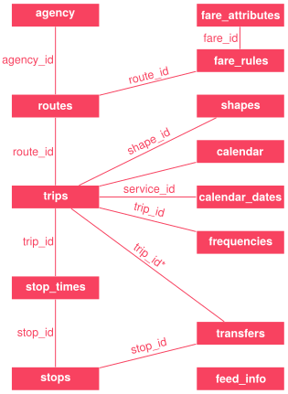

## Elements of a graph

::: {.r-fit-text .fragment .fade-in}
nodes and edges
:::

## Graphs encoding spatial weights

---

### Nodes
Geometries (points, lines, or polygons)

::: {.fragment}
### Edges
Spatial interactions (contiguity, distance, or regimes)

:::

## Graphs encoding spatial networks

---

### Nodes
Junctions

::: {.fragment}
### Edges
Links connecting them (streets, paths, transit lines, or rivers)
:::

---

::: {.r-fit-text .absolute top=25%}
(pseudo)planar graphs
:::

---

### Undirected
### Directed {.fragment}
### Multigraphs {.fragment}
### Self-loops {.fragment}

---

## Graphs encoding street networks

---

### Nodes
Street junctions

::: {.fragment}
### Edges
Street segments (junction-to-junction)
:::

---

## Edge attributes

distance, time, mode of transport, price, slope

---

::: {.r-fit-text .absolute top=25%}
routing can take them all into account
:::

## Multi-modal networks

---

::: {.r-fit-text .absolute top=25%}
General Transit Feed Specification (GTFS)
:::

---

::: {.r-fit-text .absolute top=25%}
a community-driven open standard  for rider-facing transit information
:::

---

{.center_image}

---

::: {.r-fit-text .absolute top=10%}
import pandarm
:::
::: {.r-fit-text .absolute top=40%}
import r5py
:::
